# Лабораторная работа №8: Docker Compose.

## Структура проекта

- `devops8compose/` — веб-приложение на Flask со счётчиком посещений в Redis:
  - `app.py` — код Flask-приложения.
  - `compose.yaml` — описание сервисов `web` и `redis`.
  - `dockerfile` — инструкция сборки образа приложения.
  - `requirements.txt` — зависимости Python.
- `devops8prom/` — стек мониторинга:
  - `compose.yaml` — описание сервисов `prometheus`, `grafana` и `blackbox`.
  - `prometheus/prometheus.yml` — конфигурация сбора метрик и Blackbox-проб.
  - `grafana/datasource.yml` — автонастройка источника данных Prometheus.
- `screenshots/` — скриншоты выполнения работы.

## Ход выполнения работы

### 1. Подготовка веб-приложения (Flask + Redis)

Создание Flask-приложения со счётчиком посещений в `app.py`:
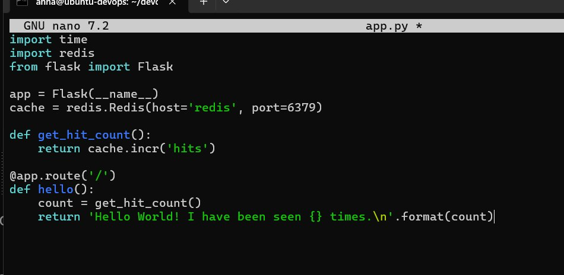

Указание зависимостей `flask` и `redis` в `requirements.txt`:
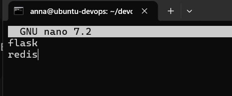

Создание `dockerfile` для сборки образа Flask-приложения на базе `python:3.10-alpine`:
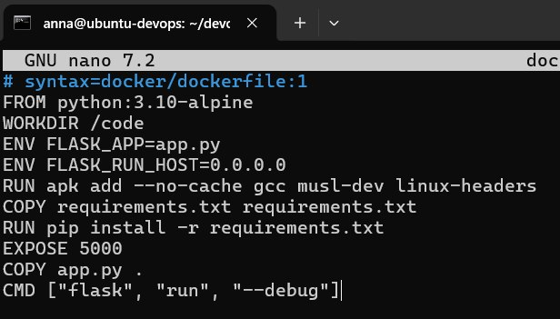

Настройка `compose.yaml` для сервисов `web` (проброс порта `8000:5000`) и `redis` (`redis:alpine`):
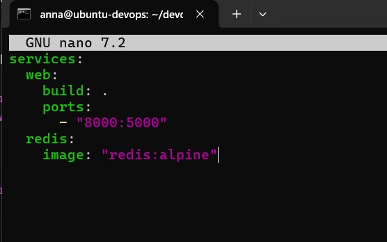

Запуск `docker compose up -d`: загрузка образа `redis`, сборка образа `web`, создание сети и запуск контейнеров `devops8compose-redis-1` и `devops8compose-web-1`:
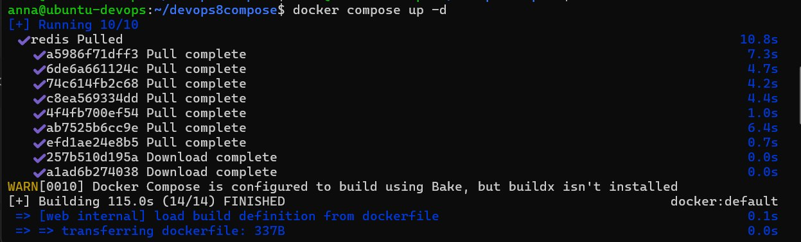
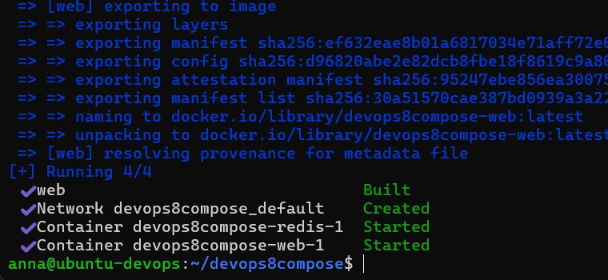

Проверка статуса контейнеров через `docker compose ps` и тестирование счётчика посещений запросами `curl 127.0.0.1:8000`:
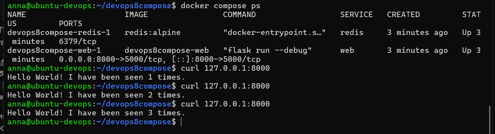

### 2. Настройка стека мониторинга (Prometheus + Grafana + Blackbox Exporter)

Настройка `compose.yaml` для стека мониторинга (фрагмент конфигурации сервиса `grafana`, порты, переменные окружения и тома `prom_data`, `grafana_data`):
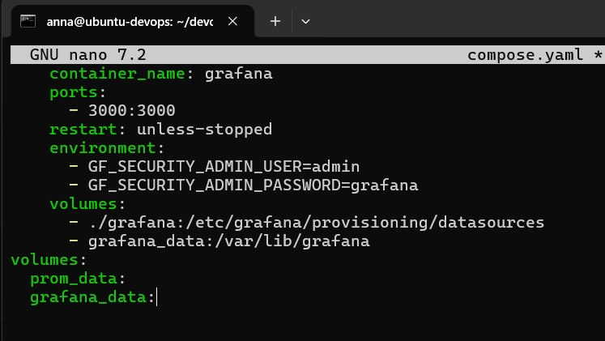

Настройка `prometheus.yml` (глобальные интервалы сбора, `alerting` и задача `prometheus` на `localhost:9090`):
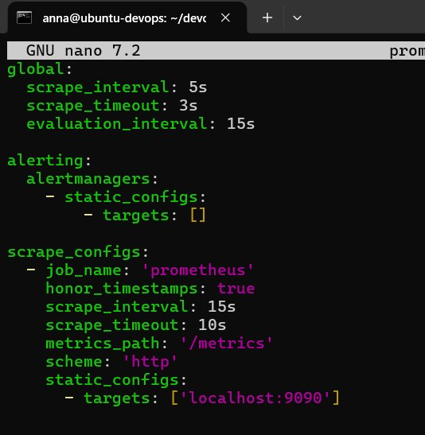

Настройка `datasource.yml` для автоматического подключения источника данных Prometheus (`http://prometheus:9090`) в Grafana:
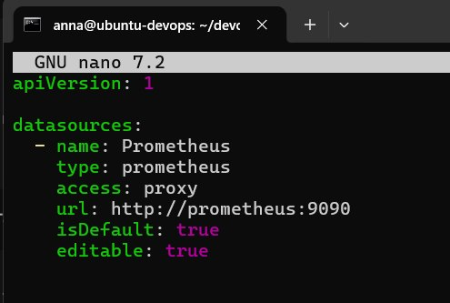

Запуск стека мониторинга через `docker compose up -d`: загрузка образов `grafana` и `prometheus`, создание сети и томов `devops8prom_grafana_data`, `devops8prom_prom_data` и запуск контейнеров `grafana` и `prometheus`:
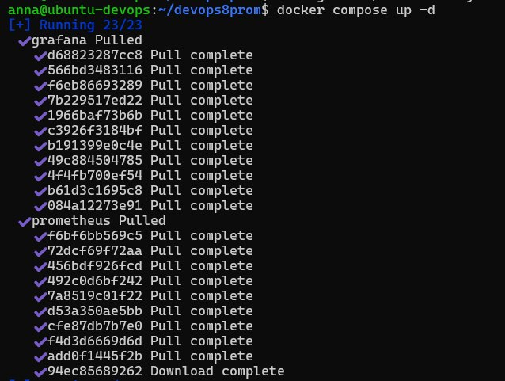
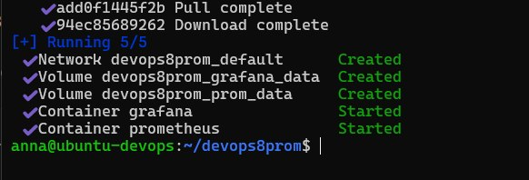

Проверка статуса контейнеров `grafana` (порт `3000`) и `prometheus` (порт `9090`) через `docker compose ps`:
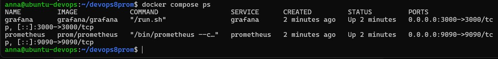

Открытый веб-интерфейс Prometheus по адресу `127.0.0.1:9090`:
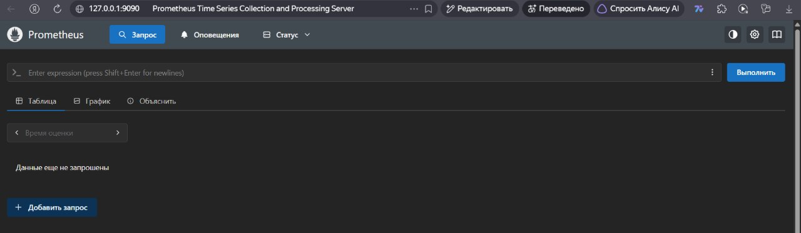

Открытый веб-интерфейс Grafana по адресу `127.0.0.1:3000`:
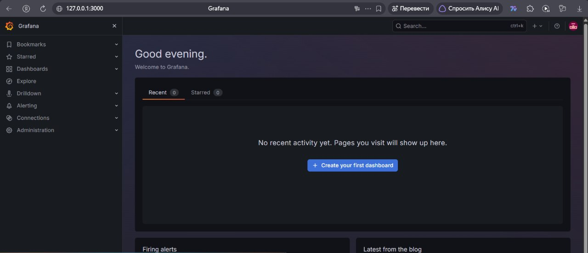

Остановка и удаление контейнеров `grafana`, `blackbox_exporter`, `prometheus` и сети `devops8prom_default` командой `docker compose down`:
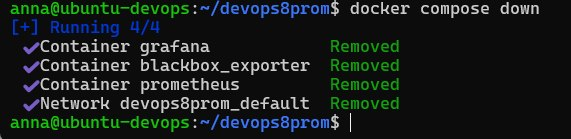

Пересборка и запуск обновлённого стека мониторинга (`docker compose build` и `docker compose up -d`) с поднятием контейнеров `prometheus`, `grafana` и `blackbox_exporter`:
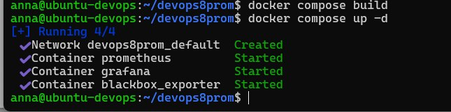

Проверка статуса сервисов `blackbox_exporter` (порт `9115`), `grafana` и `prometheus` через `docker compose ps` и обращение к веб-странице Blackbox Exporter (`curl 127.0.0.1:9115`) с просмотром результатов последних проб:
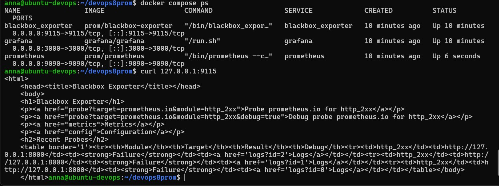

Дашборд `Blackbox Exporter (HTTP-пробник)` в Grafana с обзором HTTP-проб (`http://10.0.2.15:8000` — `UP`, `https://etis.psu.ru` — `DOWN`, `https://student.psu.ru` — `UP`) и графиком длительности проверок:
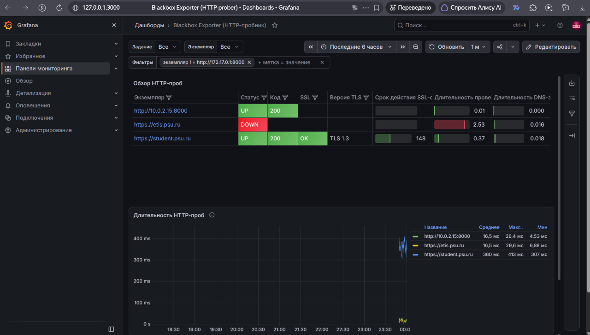